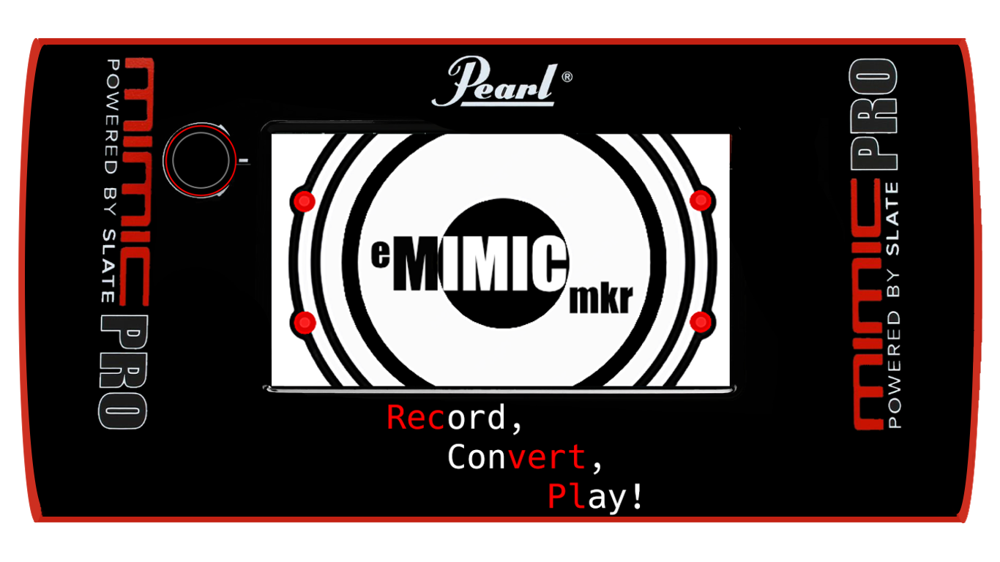

<p align="center"></p>

# eMIMICmkr
Tool to record samples from your VST libraries, and convert them into the Pearl Mimic.

Pronunciation (e-MIMIC-maker)

eMIMICmkr hosts a drum plugin (Superior Drummer 3, BFD3, Addictive Drums and others)
and works out which MIDI note plays which kit piece and zone. It records every zone
at several velocities and builds Pearl Mimic instruments (.mci) with the layers
sorted by how hard each hit was played.

## Status

| Part | State |
| --- | --- |
| .mci format | Decoded. Reader and writer work, tested on five Editor files ([docs/mci-format.md](docs/mci-format.md)) |
| Plugin hosting | Find plugins, load one, show its window, listen to any zone |
| Kit auto-mapping | Editable note map with Roland e-drum and General MIDI presets; reading the plugin's own map not yet |
| Multi-velocity recording | Batch recording of a whole kit, hi-hat openness on CC4; awaiting a Superior Drummer 3 test |
| .mci export | In the app (`Source/Core/Mci`, `WavToMci`): every instrument type, plus the WAV-folder converter. `tools/mci` holds the Python reference implementation |

## Downloads

Every push builds the app for Linux, Windows and macOS on GitHub (Actions tab, "Build",
artifacts at the bottom of a run); a version tag such as `v0.2.0` publishes them under
Releases. The macOS build is unsigned: right-click it and choose Open the first time.

Linux comes in four forms, all built for x86-64 on Ubuntu 22.04 (glibc 2.35 or newer):

| File | For |
| --- | --- |
| `emimicmkr_<version>_amd64.deb` | Debian, Ubuntu, Mint, Pop!_OS: `sudo apt install ./emimicmkr_*.deb` |
| `emimicmkr-<version>.x86_64.rpm` | Fedora: `sudo dnf install ./emimicmkr-*.rpm`; openSUSE: `sudo zypper install ./emimicmkr-*.rpm` |
| `eMIMICmkr-x86_64.AppImage` | Any distribution: `chmod +x` it and run it (needs FUSE 2, `libfuse2` on most distributions) |
| `eMIMICmkr-Linux-x86_64.tar.gz` | The bare program, with `eMIMICmkr.desktop` and `eMIMICmkr.png` for a menu entry |

On Arch, `packaging/aur/PKGBUILD` builds `emimicmkr-git` from the latest source (`makepkg -si`
in that folder); it is ready to publish on the AUR once the repository is public. On Nix and NixOS, the
flake at the repository root builds it: `nix run github:Sharkuel/eMIMICmkr` to try it, or add
`inputs.emimicmkr.url = "github:Sharkuel/eMIMICmkr";` to your system flake and
`emimicmkr.packages.${pkgs.system}.default` to `environment.systemPackages` (yabridge is in
nixpkgs too). There is no
Flatpak: its sandbox can't reach plugins installed on the system or run yabridge's Wine.

## Building the app

You need CMake 3.22+ and a C++17 compiler. JUCE 8 is downloaded automatically.

```
cmake -B build -DCMAKE_BUILD_TYPE=Release
cmake --build build --config Release
```

On Linux, install the JUCE dependencies first, for example on Debian/Ubuntu:

```
sudo apt install libasound2-dev libx11-dev libxrandr-dev libxinerama-dev \
  libxcursor-dev libfreetype-dev libfontconfig1-dev
```

On Linux, Windows plugins can run through a bridge such as yabridge, which exposes
them as VST3 plugins the app can load.

## Recording a kit

1. **Find plugins**, pick your drum plugin and **Load plugin**. Load a kit in the plugin window.
   Type in **Search plugins** to narrow a long list (any part of the name or maker). Drum plugins
   are listed first, other plugins below them. With yabridge, run `yabridgectl sync` after adding
   a plugin folder, then **Find plugins** again: the bridged copies land in `~/.vst3/yabridge`.
   A plugin that failed or took over 5 minutes to open is skipped; remove it from the Find plugins
   list and scan again to retry it.
2. Pick the note map. **e-drum (Roland TD, hi-hat on CC4)** is the default: set the plugin's
   MIDI input map to its Roland TD preset (Superior Drummer 3: Settings > MIDI In/E-Drums) so
   the notes match and the hi-hat opens and closes with CC4. Every cell of the table can be
   edited: double-click a note to change it, untick a zone to skip it.
3. Select a row and **Listen to zone** to check the note plays the right sound. Other ways to
   build the map, since each library maps notes its own way:
   - **Learn notes**: select a row, hit the pad or key on your e-kit or MIDI keyboard (or click
     the drum in the plugin's window: the app first plays every note once and matches the click
     by sound), and the
     note is filled in and the next row selected.
   - **Find notes**: plays every note once, adds any the map lacks as "?" rows to listen to and
     name, and shows mapped rows that play nothing in red.
   - **Read plugin**: with Superior Drummer 3, BFD3, MODO DRUM, Ugritone's drums (KVLT Drums II), DW Soundworks or Addictive Drums 2, reads the loaded kit straight from the
     plugin: every instrument slot, its articulations and their notes (main zones ticked). BFD3
     also gives each drum's name ("Snare AXM Open High") and library ("Crush Drums"), which fill
     Name on the Mimic and Library; MODO DRUM gives each instrument's name ("Crash 16 Custom") and
     leaves out the slots switched off in its kit. Each MODO DRUM drum has a note per hand: the left
     hand's is ticked, the right hand's is there to tick. Ugritone gives each panel's drum ("DM Custom Z17"),
     the kit name and its Midinote Settings map. DW Soundworks gives each drum's name
     ("DW TrueCast 6.5x14 Snare Drum") and kit ("DW Maple Mahogany"); its hi-hat openings, snares-off
     snare (another snare piece, unticked) and cymbal bells are there to tick. DW can put several
     drums on one note and plays them together; only the first is ticked, the others say which drum
     they share the note with: give each its own note in DW to record it alone. Addictive Drums 2
     gives the kit preset ("Black Room"), its ADpak ("Black Oyster") and the note of every
     articulation in its key map, but no drum names: type them once and they are kept by AD2's ID
     for the drum. Its cymbal slots come in as crashes, its Flexi slots as percussion, and its open
     hats fill the Mimic hat's bow and edge alike. Other VST3 plugins fill the "Name in plugin" column from their
     note names. **Open map...** also opens an SD3 preset (.sd3p) or a BFD3 kit preset (.bfd3kit)
     the same way; a BFD3 kit preset has no MIDI map, so BFD3's default "BFD 3.0" map is assumed.
     A BFD3 drum that its MIDI map gives no note (the default map has none for some cymbal slots)
     is left out: give it a note in BFD3's key map and read again.
     It also opens the MIDI map that MDL Tone's Ultimate Heavy Drums saves from Kontakt (.nka): Kontakt
     keeps no kit in its own state, so save the library's mapping and open it here. Kick, snare, six
     toms, both hi-hats, two rides and the chinas, crashes and splashes come in with their main
     articulations ticked; chokes, the tight hat, the second hat and the second kick are there to tick.
     Other Kontakt libraries keep their kit encrypted in Kontakt's state, so their default maps are
     built in: pick Eloy Drums (CasaGroove, CasaGrande), Trivium Drums, Krimh Drums, GGD Invasion or Odeholm Drums (its default map, or the other one some videos show) in the note map
     list. They follow each library's default Mapping page; if you changed it there, fix the notes here
     or with Learn.
   - **Piece** groups rows into one Mimic instrument. Typing a piece name changes that row only:
     another piece's name moves the row into it, a new name makes a new piece.
   - Pieces whose labels start with PERC (or OCTOBAN, COWBELL, SHAKER...) become Mimic percussion
     instruments with up to four zones: labels ending MAIN, SECONDARY, ADD1 and ADD2 take those
     zones, other labels fill them in order. SD3 slots that aren't drums or cymbals (octobans,
     chimes) are read this way.
   - **Name on the Mimic**, **Library** and **Image**: what the Mimic shows for each piece (the
     Editor's "Displayed Instrument Name", "Displayed Library Name" and 94x63 PNG image). Empty
     names and libraries show greyed what the Mimic gets instead (the kit name and piece; the kit
     name). Double-click to type; a library name applies to every piece from the same plugin
     library. Click an Image cell to choose, paste or capture a picture, or drop an image file on
     it; any picture is resized to 94x63. A picture from a file (chosen, dropped, or copied in a
     file manager and pasted) can also name the piece: "5x14_DW_Timeless_Timber_Maple.png" offers
     "5x14 DW Timeless Timber Maple" and "YamahaVintage.png" "Yamaha Vintage" (the Image menu's last item does it without asking). With SD3, names and pictures are remembered by SD3's ID
     for the drum and come back in every kit that uses it. Mimic kit presets find instruments by
     name, so settle the names before saving kit presets on the Mimic.
   - **Capture...**: takes a screenshot (with grim on Hyprland and Sway, Spectacle on KDE, or
     gnome-screenshot, scrot, maim or ImageMagick on Linux; built in on macOS and Windows) and shows it full screen. Drag a box
     around a piece's picture or name in the plugin's window and choose **Picture of**, **Name
     of** or **Library name**; names are read from the picture with
     [Tesseract OCR](https://github.com/tesseract-ocr/tesseract), which must be installed. Esc
     or right-click closes it.
   - **Save map...** / **Open map...**: keep a map per library as a .csv file
     (`piece,zone,note,cc4,record,hits,instrument,name,library,image`), which a spreadsheet can edit too.
   Tom rimclicks and the snare rimclick have no Roland note, so their rows start unticked.
4. Set **Most hits per zone** (default 127, spread from velocity 127 down to 1) and **Record kit**.
   With **Fit Mimic limits** on, each piece records only as many hits as the Mimic can hold
   (kick 64, snare 300, toms 200, 2-zone cymbals 200, rides 300, shared across the piece's
   zones); the **Hits** column shows the count per row. Double-click a Hits cell to set a zone's
   count yourself (marked *); the piece's other ticked zones share what is left.
5. When the recording ends, the app asks whether to convert the WAV files to Mimic instruments now.
   **Convert** builds them into `<Save to folder>/<kit name>/Mimic/` and opens that folder;
   **Choose folder...** builds them anywhere else, such as a USB stick for the Mimic (remembered for next time);
   **Not now** leaves the WAV files for **Convert WAV folder...** later.

**Convert WAV folder...** builds Mimic instruments from one or several folders (or a .zip) of WAV hits in
the layout below, such as a kit you recorded yourself or a WAV library, into a `Mimic`
folder inside it. **Also make hi-hats as 3-zone rides** adds a ride-type copy of each hi-hat.
A piece folder (the one holding its zone folders) may hold `mimic.txt` (`name: ...` and
`library: ...` lines) and `mimic.png` (94x63); recordings get them from the table, and the
converter puts them in the instrument.

**Build Mimic kit...** makes a Mimic kit preset (`.kit`) from `.mci` files (pick them, or the
folder holding them). It starts from one of your own Mimic kits, picked once and remembered
(**Other kit to start from...** changes it), so its pad and trigger settings and its mixer
carry over; the instruments go in its slots (kick, snare, hi-hat, ride, toms smallest first,
crashes, then Aux and Xtra), every other slot is emptied, and each channel is panned to the
centre. The kit is written next to the instruments as `<kit name>.mdp/[U] <kit name>.kit`,
the way the Mimic stores its own. The Mimic finds a slot's instrument by its name and library,
so keep the `.mci` files as they were made, and copy them to the Mimic along with the kit.

Hits are recorded offline at 44.1 kHz, mixed to centred mono from the plugin's main output,
and saved as 24-bit WAVs under `<Save to folder>/<kit name>/` (Documents/eMIMICmkr unless you pick another with **Change...**), one folder per zone, in
the layout the converter reads (below). The hi-hat is recorded at five pedal positions
(CC4 127, 96, 64, 32, 0) on both bow and edge, plus the pedal chick.

`cmake --build build --target eMIMICmkr_tests` builds a check of the recorder against a
stand-in plugin; `tests/test_batch_recording.py` runs it and converts the result.

## The .mci tools

`tools/mci/mci.py` reads, writes and builds Mimic instruments, with no dependencies
beyond Python 3. To run its tests against your own Editor files:

```
pip install pytest
MCI_SAMPLES=/path/to/folder/with/mci python3 -m pytest tests
```

### Converting rendered WAVs

The app turns hits rendered by SDSE, a similar tool or its own batch recorder into Mimic
instruments, with no Python needed (`emk::WavToMci` in `Source/Core`). It reads a zip or a
folder laid out one folder per zone, with files named
`<piece> - <ZONE> - <hit>v<velocity>.wav`, and writes one `.mci` per kit piece. Several
folders given together (say a ride's `BOW`, `BELL` and `EDGE` folders, or several kit
pieces) are read as one input, their files named relative to the folder holding them all,
so they convert exactly like that folder would; a single zone folder converts on its own too.
A .zip among several inputs is skipped: convert it on its own.

Each zone's hits are sorted by velocity and split into velocity layers of about 4 to 6
round robins: 6 on snare heads and rims, 5 on tom heads and rims, 4 on kicks, sidesticks,
rimclicks and cymbals. That makes round(hits / round robins) layers, from 1 to 20; when a
zone has more than 6 hits per layer to fill, it keeps an even spread of velocities. Hi-hats
keep 8 layers of up to 32 hits.

Cymbals with a bell become 3-zone ride-type instruments, the rest 2-zone cymbals, and a
choke sound is made from the hardest edge hit when none was recorded. Kicks, snares and
toms are recognised too, and SDSE hi-hat folders become a Mimic hi-hat (add `--hat-as-ride` for
a 3-zone ride-type version as well). WAVs must be 44.1 kHz.

A snare's shallow rimshots (zone labels with `SHALLOW`, or `RIMSHOT SIDE`) fill the Mimic's
Rim Shot Side zone. Most libraries have none; then each rimshot is mixed 50/50 with the rim
click (or, without one, the head hit) nearest its velocity, so that zone still plays.

The converter also runs headless, from the `eMIMICmkr_mci_tests` console tool:

```
cmake --build build --target eMIMICmkr_mci_tests
build/eMIMICmkr_mci_tests_artefacts/Release/eMIMICmkr_mci_tests --convert "22 ZILDJIAN K Dark Medium Ride.zip" --out ~/Mimic
build/eMIMICmkr_mci_tests_artefacts/Release/eMIMICmkr_mci_tests --convert "My Kit Ride/BOW" "My Kit Ride/BELL" "My Kit Ride/EDGE"
```

Options: `--out DIR` (default: next to the input, or for several, the folder holding them all), `--name NAME` (only when the input holds
one piece), `--no-choke` (leave the Choke Ring empty) and `--hat-as-ride`. Run with no
arguments, the tool checks the codec and builders instead.

`tools/mci/wav2mci.py` stays as the reference implementation and takes the same options:

```
python3 tools/mci/wav2mci.py "22 ZILDJIAN K Dark Medium Ride.zip" --out ~/Mimic
```

`tests/test_cpp_converter.py` converts the same inputs with both and checks the files are
identical: metadata, RAM heads and compressed audio (so far byte for byte). Set
`EMIMICMKR_MCI_TESTS` to the tool's path when the build folder is not `./build`, and
`MCI_REAL=1` to include the real SDSE zips in `MCI_SAMPLES` (slow: the Python side takes
minutes per zip).

## Licensing

eMIMICmkr is an independent project, not made or endorsed by Pearl or Slate Digital. Pearl, Mimic
and Mimic Pro are their owners' trademarks.


eMIMICmkr is GPLv3. JUCE 8's open-source licence is AGPLv3, so the app as a whole is
distributed under AGPLv3 terms unless a JUCE commercial licence is used.

Converted kits contain samples owned by the plugin maker. Check your plugin's licence
before using them anywhere but your own Mimic, and never share or sell them.
